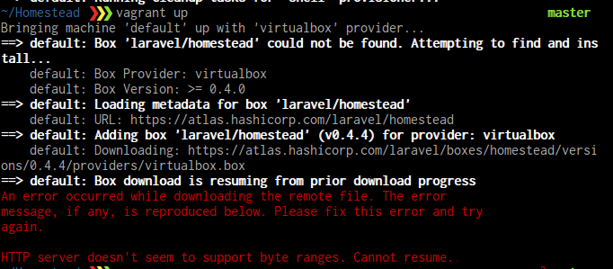

I ran into an error today while upgrading one of my Vagrant boxes. My computer shut down before the download finished. When I restarted it and tried to resume the download, Vagrant reported that the HTTP server didn't seem to support byte ranges.



After a quick search on Stack Overflow, I found a fix. I cleared Vagrant's temporary directory to remove the incomplete download.

```sh
cd ~/.vagrant.d/tmp &&
  rm -rf -- *
```

I hope this helps someone who runs into the same error. I'm still working on my English, so please let me know if you spot a mistake.
